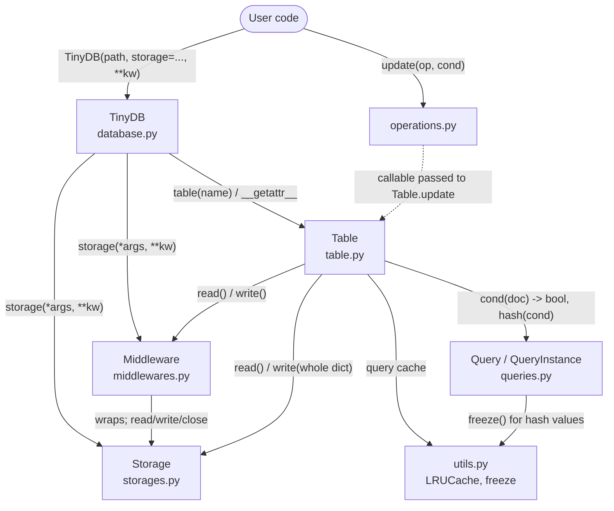

# TinyDB — Architecture

TinyDB is a small, pure-Python, document-oriented database. A database is a single nested
`dict` (`{table_name: {doc_id: document}}`) that is held by a pluggable *storage* and manipulated
by *tables*; *queries* are hashable callables that tables evaluate against documents.

## 1. Overview of the main components

| Component | File | Responsibility |
|---|---|---|
| **TinyDB** (database) | `tinydb/database.py` | Entry point. Constructs the storage from the `storage=` argument (default `JSONStorage`), forwarding every other positional/keyword argument to the storage constructor. Creates and caches `Table` objects by name, lists/drops tables, and forwards unknown attributes (`insert`, `search`, ...) and `len`/`iter` to the default table `_default`. Context manager that closes the storage. |
| **Table / Document** | `tinydb/table.py` | All document CRUD (`insert`, `search`, `get`, `update`, `upsert`, `remove`, `truncate`, `count`). Assigns integer document IDs, converts raw dicts to `Document` objects (a `dict` with a `doc_id`), and keeps a per-table **query cache** (`LRUCache`, default capacity 10). |
| **Query / QueryInstance** | `tinydb/queries.py` | Query builder. `Query()` records a field path (`Query().a.b`, `Query()['a']`, `.map(fn)`); comparison and test methods (`==`, `<`, `exists`, `matches`, `search`, `test`, `any`, `all`, `one_of`, `fragment`) return a `QueryInstance`: a callable `doc -> bool` plus a hash value used as the query-cache key. Instances combine with `&`, `|`, `~`. `where(key)` is shorthand for `Query()[key]`. |
| **Storages** | `tinydb/storages.py` | Persistence. Abstract `Storage` (`read`, `write`, optional `close`); `JSONStorage` (one JSON file, kept open, rewritten in full on every write); `MemoryStorage` (keeps the dict in memory). |
| **Middlewares** | `tinydb/middlewares.py` | Decorators around a storage class with the same `read`/`write`/`close` interface. `CachingMiddleware` keeps the last state in memory and only writes through every `WRITE_CACHE_SIZE` (1000) writes, on `flush()` or on `close()`. |
| **Operations** | `tinydb/operations.py` | Ready-made update callables (`delete`, `add`, `subtract`, `set`, `increment`, `decrement`) passed to `Table.update`; each returns a function that mutates a document in place. |
| **Utils** | `tinydb/utils.py` | `LRUCache` (query cache), `freeze()` / `FrozenDict` (turn lists/dicts/sets into hashable values for query hashes), `with_typehint()` (lets `TinyDB` look like a `Table` to type checkers; `mypy_plugin.py` adds MyPy support for it). |

Public API re-exported by `tinydb/__init__.py`: `TinyDB`, `Storage`, `JSONStorage`, `Query`, `where`.
Tests live in `tests/`, one `test_<module>.py` per module, as plain pytest functions; the shared
`db` fixture in `tests/conftest.py` runs table tests against both `MemoryStorage` and `JSONStorage`.

### Who calls whom

Typical flow of `db.search(Query().age > 18)`: `TinyDB.__getattr__` forwards to the default `Table`;
`Table.search` looks the query up in its `LRUCache`; on a miss it calls `storage.read()`, evaluates the
query on every raw document, wraps matches as `Document`s and caches them under the query.
A write (`insert`, `update`, `remove`, ...) goes through `Table._update_table`: read the **whole**
database dict, apply an updater function to this table's documents, write the whole dict back, then
clear the table's query cache.

## 2. Architecture Decision Records

### ADR-1: Storages read and write the whole database as one dict
**Status:** Verified — stated in the docstring of `Table._update_table` (`tinydb/table.py:804-816`) and in the `TinyDB` "Data Storage Model" docstring (`tinydb/database.py:48-66`).

- **Context.** TinyDB targets small datasets and wants storages to be trivial to write (JSON file, memory, YAML, ...).
- **Decision.** The storage interface has only `read() -> dict | None` and `write(dict)`. A storage never
  sees individual tables or documents; `Table` performs every change as read–modify–write of the full dict.
  Document IDs are converted to `str` before writing and back to `document_id_class` (int) after reading,
  because JSON object keys can only be strings.
- **Alternatives considered.** A record-level API (`get(doc_id)`, `put(doc_id, doc)`), or per-table files.
  Both would be faster for large data but would make every storage implementation more complex.
- **Consequences.** Any serialisation format can be added by implementing two methods. Every write costs
  O(size of database); speed comes from `CachingMiddleware`, not from the storage. `read()` returning `None`
  means "empty / uninitialised" and every caller handles that case.

### ADR-2: Middlewares wrap storage *classes* and are constructed lazily
**Status:** Verified — explained in the `Middleware.__call__` docstring (`tinydb/middlewares.py:25-65`).

- **Context.** Users need cross-cutting behaviour (caching, logging) on top of any storage, but `TinyDB`
  constructs the storage itself from `storage=` and its own arguments.
- **Decision.** A middleware is instantiated with the *storage class* (`CachingMiddleware(JSONStorage)`).
  `TinyDB` then calls it like a class; `Middleware.__call__` constructs the real storage with the forwarded
  arguments and returns the middleware. Unknown attributes are forwarded to the wrapped storage
  (`__getattr__`), so middlewares are transparent and can be nested.
- **Alternatives considered.** Passing storage instances (`TinyDB(storage=CachingMiddleware(JSONStorage('x.json')))`)
  or subclassing each storage per feature.
- **Consequences.** `TinyDB`, `Table` and storages need no knowledge of middlewares; any new storage works
  with existing middlewares automatically *as long as it honours the plain `read`/`write`/`close` contract*.
  With `CachingMiddleware`, data reaches disk only on `flush()`/`close()` (or every 1000 writes).

### ADR-3: Per-table query cache keyed by a structural query hash
**Status:** Verified — `Table` "Query Cache" admonition (`tinydb/table.py:41-50`), the `QueryLike`/`QueryInstance`
docstrings (`tinydb/queries.py:35-73`), and the comments referencing issue #637 at `tinydb/queries.py:358-360`.

- **Context.** Repeated identical searches are common; evaluating a query means scanning every document.
- **Decision.** Every `QueryInstance` carries a hash value: a tuple describing the operation, the field path and
  its arguments (arguments made hashable with `utils.freeze`). Two queries with equal hash values are *equal*
  (`QueryInstance.__eq__`) and share a cache entry. `Table.search` caches results in an `LRUCache`; every write
  through `_update_table` clears it. A query whose result cannot be described by its structure (e.g. one using
  `.map(fn)`) gets hash value `None` and is marked non-cacheable (`is_cacheable() is False`).
- **Alternatives considered.** No cache (always scan), or caching by object identity (would almost never hit
  because users rebuild queries).
- **Consequences.** Fast repeated reads, but **correctness of search depends on the hash**: if two queries that
  can return different results produce the same hash value, the second one silently returns the first one's
  cached results. `&`/`|` hashes use `frozenset` so they are order-insensitive. `Query.test` warns that the
  test function must be deterministic for the same reason.

## 3. Constraints (rules not to break)

1. **New storages subclass `Storage` and honour its contract.** Implement `read()` and `write(data)` (abstract
   methods), return `None` from `read()` when nothing has been stored yet, write the complete dict passed in,
   and release resources in `close()` if any are held. Middlewares and `TinyDB` rely only on this interface.
   *Seen in:* `tinydb/storages.py:36-76` (abstract base), `tinydb/storages.py:125-134` (empty file → `None`).
2. **Storage construction goes through `TinyDB.__init__`.** `TinyDB` pops `storage` (default
   `default_storage_class`) and passes *all other* positional and keyword arguments unchanged to that class;
   storages and middlewares must accept their configuration this way (e.g. JSON `indent`/`sort_keys` reach
   `json.dumps` via `**kwargs`). *Seen in:* `tinydb/database.py:87-98`, `tinydb/storages.py:84-106,147`.
3. **Every query test is built with `Query._generate_test` and its hash value must include every argument that
   affects the result** (frozen with `freeze()`), or be `None` if the query cannot be cached. Leaving an argument
   out of the hash makes different queries share a cache entry. Test functions must not raise for documents
   whose field is missing — path resolution already returns `False` on `KeyError`/`TypeError`.
   *Seen in:* `tinydb/queries.py:218-252`, `tinydb/queries.py:358-360`, `tinydb/queries.py:76-85`.
4. **All table mutations go through `Table._update_table`.** It converts IDs, writes the whole dict back and
   clears the query cache; writing to the storage directly from a table method would leave stale cached results.
   *Seen in:* `tinydb/table.py:804-854`.
5. **Dependency direction is one-way.** `utils.py` and `storages.py` import no other TinyDB module; `queries.py`
   imports only `utils`; `table.py` imports `queries`, `storages`, `utils`; `database.py` sits on top and imports
   `storages`, `table`, `utils`. `middlewares.py` uses only `Storage` (imported via the `tinydb` package).
   Lower layers must never import `database.py` or `table.py` (e.g. `queries.py` must not import `table.py`).
   TinyDB has **no runtime third-party dependencies** (no `dependencies` in `pyproject.toml`; `mypy_plugin.py`
   imports `mypy` but is only loaded by the type checker). *Seen in:* the import blocks at the top of
   `tinydb/queries.py:19-23`, `tinydb/table.py:6-17`, `tinydb/database.py:5-10`, `tinydb/middlewares.py:5-7`,
   `tinydb/storages.py:6-11`; `pyproject.toml` (no `dependencies` key).
