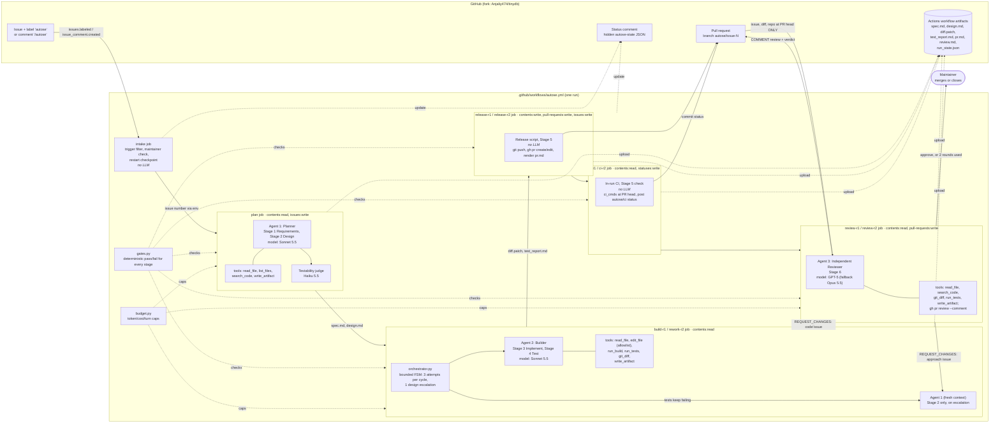

# Component View — AutoSE Issue-to-PR Workflow

This view shows every component, the tools each one may use, the GitHub token permissions of the
Actions job it runs in, and how components call each other. It reflects ADR-001 (split), ADR-002
(control flow), ADR-005 (tools) and ADR-008 (reviewer independence).

## What each component can and cannot do

| Component | Job permissions | Can | Cannot |
| :--- | :--- | :--- | :--- |
| Intake | `issues: read` | Read the trigger event, check the actor's repo permission, read the status comment | Call any model |
| Agent 1: Planner | `contents: read`, `issues: write` | Read the repo, write `spec.md` / `design.md`, update the status comment | Edit code, run shell commands, push |
| Agent 2: Builder | `contents: read` | Edit files inside `allowed_edit_paths`, run build and tests locally | Push, call `gh` write commands, edit `.github/` or `workflow/` |
| Release script | `contents: write`, `pull-requests: write`, `issues: write` | Push `autose/issue-N`, open or update the PR | Merge, push to `master`, run a model |
| In-run CI | `contents: read`, `statuses: write` | Run `ci_cmds`, post the `autose/ci` status | Change code, PRs or issues |
| Agent 3: Reviewer | `contents: read`, `pull-requests: write` | Read the issue, diff and repo at PR head, run tests, post a `COMMENT` review | Push, approve, merge, read Stage 1–5 artifacts |

## Information Barriers

- The Reviewer job never runs `actions/download-artifact`, so it cannot see `spec.md`, `design.md`,
  `test_report.md`, `pr.md` or any agent transcript (ADR-003, ADR-008).
- Untrusted issue text reaches only Agent 1 (Stage 1) and Agent 3, both read-only. The Builder
  works from `spec.md` and `design.md`, which have passed their gates (ADR-003, ADR-009).
- `gates.py`, not the agents, decides pass or fail and which stage runs next (ADR-007).
