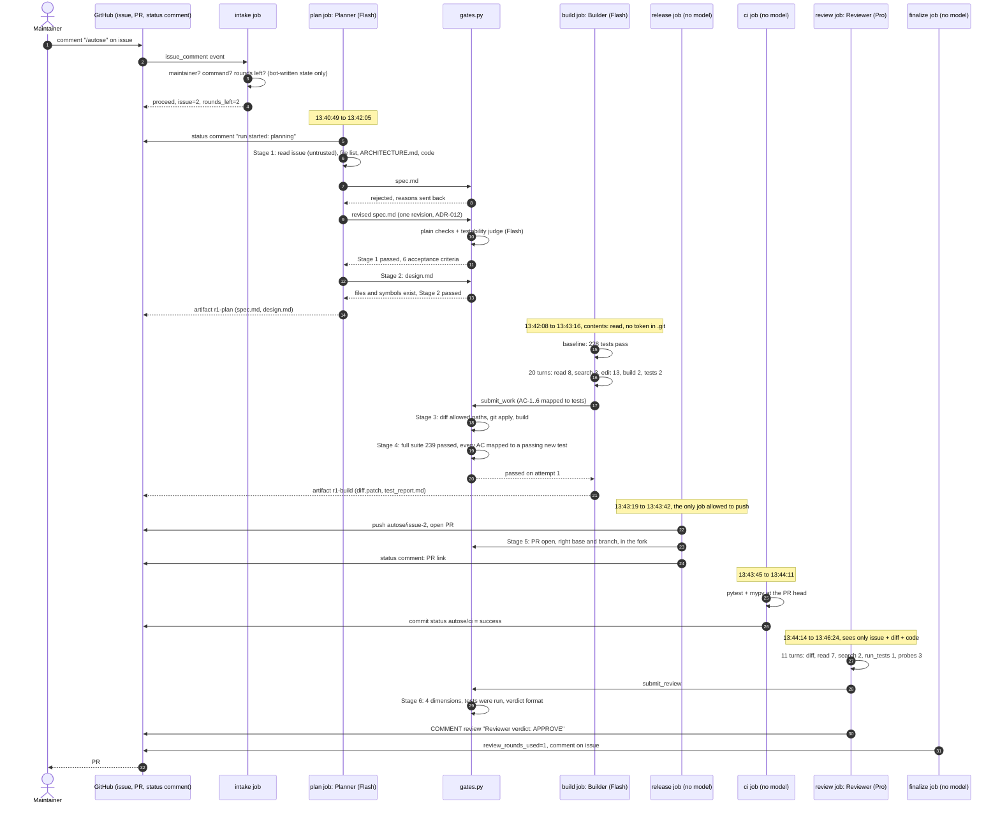

# Sequence View: one real run, issue #2 to its review

This is [run 45186252584](https://github.com/Anjaliy474/tinydb/actions/runs/45186252584) on
[issue #2](https://github.com/Anjaliy474/tinydb/issues/2) ("remove() crashes if the same id is
passed twice"), started by a `/autose` comment. It produced
[PR #19](https://github.com/Anjaliy474/tinydb/pull/19), which passes all three hidden tests, and an
APPROVE review. Times are UTC on 23 Nov 2026; tokens and tool calls come from the run's artifacts
(`run_state.json` and the `*_agent_log.json` files).

At the time of this run the planner and builder used `deepseek-flash` and the reviewer used
`deepseek-v4-pro` (ADR-013). Later runs use `deepseek-flash` for every role.

## Per stage

| Stage | Job | Wall time | Model calls | Tokens | Est. cost |
| :--- | :--- | :--- | :--- | :--- | :--- |
| 1-2 Requirements, design | plan | 1 min 16 s | 15 | 170,336 | $0.022 |
| 3-4 Implementation, testing | build-r1 | 1 min 8 s | 20 | 295,821 | $0.014 |
| 5 Release | release-r1 | 23 s | 0 | 0 | $0 |
| 5 Check: CI | ci-r1 | 26 s | 0 | 0 | $0 |
| 6 Independent review | review-r1 | 2 min 10 s | 11 | 165,688 | $0.053 |
| Whole run | | **6 min 13 s** | 46 | 631,845 | **$0.089** |

Things this run shows about the design:

- The planner's first spec failed a gate and was fixed in the same conversation, without a person
  (ADR-012).
- The builder never saw the issue text, only `spec.md` and `design.md` (ADR-003).
- Only the release job had write access, and it ran no model (ADR-001, ADR-005).
- CI ran inside the workflow, because pushes made with the workflow's token don't start other
  workflows (ADR-002).
- The reviewer ran on a different model, never downloaded the planner's or builder's artifacts,
  and approved only after running the tests and three probes of its own (ADR-008).
- Nothing was merged. The run ends with a PR and a review for a person to judge.
